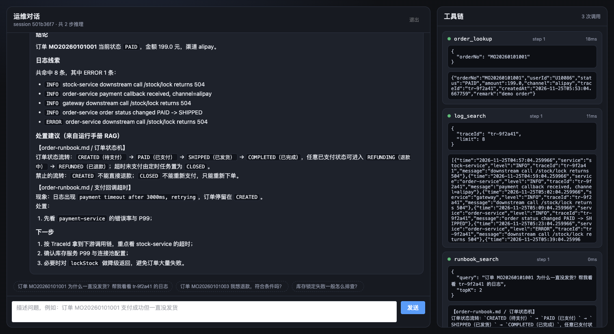
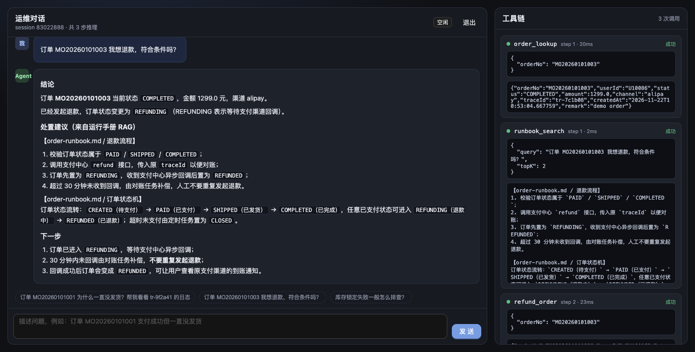
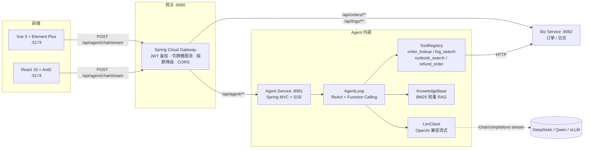

# MoMo AIOps Agent

> 一个能真正跑起来的 **Java AI Agent** 实战项目：Spring Boot 3 + Spring Cloud Gateway + Vue 3 / React 18，用 Function Calling 把「查订单、查日志、查运行手册、发起退款」串成一条可观测的 Agent 链路，前端 SSE 实时看到每一步。

不是一个只会调一次 Chat Completions 的 demo：它有工具编排、流式协议、会话记忆、输入护栏、超时与步数止损、审计友好的事件流，以及两套可选前端。




---

## 1. 它解决什么问题

一线客服/值班同学遇到「订单支付成功但一直没发货」这类问题时，通常要开 3 个系统：订单后台查状态、日志平台按 TraceId 搜报错、Wiki 里翻运行手册。整个过程 5~10 分钟，且高度依赖经验。

这个项目把这套动作交给 Agent：

```
用户：订单 MO20260101001 为什么一直没发货？帮我看看 tr-9f2a41 的日志
Agent：
  step 1 → order_lookup(MO20260101001)        → PAID / 199 元 / alipay / tr-9f2a41
  step 1 → log_search(traceId=tr-9f2a41)      → 8 条，其中 1 条 ERROR: /stock/lock 504
  step 1 → runbook_search("订单没发货…")       → 《订单状态机》《支付回调超时》
  step 2 → 汇总结论 + 处置建议 + 风险提示
```

关键在于：**模型不直接碰数据库**。所有事实都必须经过工具 → 业务服务 API 获取，模型只负责决策与表达。

---

## 2. 架构



| 模块 | 技术 | 职责 |
|---|---|---|
| `gateway` | Spring Cloud Gateway + Resilience4j + JJWT | 统一入口、鉴权、限流、熔断 |
| `agent-service` | Spring Boot 3 + SSE + 手写 SSE 客户端 | Agent 编排、工具、RAG、护栏 |
| `biz-service` | Spring Boot 3 + JPA + H2 | 订单/日志领域服务（可换 MySQL） |
| `common` | 纯 Java | 统一响应、DTO、异常 |
| `web-vue` / `web-react` | Vite + Vue 3 / React 18 | 对话 + 工具链可视化 |

---

## 3. 快速开始

### 3.1 零依赖跑通（推荐先做这一步）

需要 JDK 17+、Maven 3.9+。**默认使用本地 mock 模型，无需任何 API Key。**

```bash
# 1) 编译 + 跑测试（27 个用例）
mvn -B clean package

# 2) 一键拉起三个后端
bash scripts/run-all.sh

# 3) 冒烟：登录 -> 401 校验 -> 查订单 -> Agent 同步/流式
bash scripts/smoke.sh
```

然后启动前端：

```bash
cd web-vue && npm install && npm run dev     # http://localhost:5173  admin/admin123
cd web-react && npm install && npm run dev   # http://localhost:5174  admin/admin123
```

### 3.2 接真实模型

`agent-service` 走的是 OpenAI 兼容协议，DeepSeek / 通义 / 自建 vLLM 都能直接换：

```bash
export AGENT_LLM_MODE=openai
export AGENT_LLM_BASE_URL=https://api.deepseek.com/v1
export AGENT_LLM_API_KEY=sk-xxxx
export AGENT_LLM_MODEL=deepseek-chat
# 重新启动 agent-service 即可
```

想验证「真模型 + 真工具」，就让它查 `MO20260101003` 并退款——注意订单状态会真的变成 `REFUNDING`（内存库，重启即还原）。

### 3.3 Docker Compose

```bash
cp .env.example .env      # 需要真模型就填 API Key
docker compose up -d --build
# 前端：http://localhost:5173 / http://localhost:5174
```

---

## 4. 目录结构

```
momo-ai-agent
├── common/                      # 统一响应体 / DTO / 业务异常
├── biz-service/                 # 订单 + 日志领域服务（H2 内存库，启动灌数据）
│   └── src/main/resources/data.sql
├── agent-service/               # 核心：Agent 运行时
│   └── src/main
│       ├── java/com/momo/ai/agent
│       │   ├── core/            # AgentLoop / Session / 输入护栏 / 事件模型
│       │   ├── llm/             # OpenAI 兼容流式客户端 + 本地剧本模型
│       │   ├── tool/            # 工具接口、注册表、业务工具
│       │   └── rag/            # BM25 知识库
│       └── resources
│           ├── knowledge/       # 运行手册（被 RAG 索引）
│           └── prompts/         # 系统提示词
├── gateway/                     # JWT / 限流 / 熔断 / 路由
├── web-vue/  web-react/         # 两套前端，功能等价
├── docker/  docker-compose.yml
└── scripts/                     # run-all.sh  smoke.sh
```

---

## 5. 核心设计

### 5.1 Agent Loop：一个可读的 ReAct 实现

`agent-service/.../core/AgentLoop.java` 是整个项目的心脏，去掉注释不到 100 行：

```
for (step = 1..maxSteps) {
    resp = llm.stream(messages, tools)          // 边流边推给前端
    if (resp 没有 tool_calls) → final 并结束
    把 assistant(tool_calls) 加入上下文
    for each tool_call:
        校验工具名 / 参数大小 / 是否允许写操作
        执行（带超时，失败也转成结构化结果）
        把 tool 结果加入上下文
}
```

几个刻意的取舍：

- **同步阻塞而非响应式**：LLM 调用与工具执行串行完成，逻辑线性、可断点调试；并发交给 Web 容器（每个 SSE 请求一个工作线程）。响应式写法在这里只会让栈更难读。
- **工具失败不中断**：工具报错会作为 `tool` 消息喂回模型，让它自己决定换工具还是直接回答——这才是 Agent 该有的鲁棒性。
- **历史裁剪按「整轮」切**：如果只保留 `tool` 消息却丢了配对的 `assistant.tool_calls`，OpenAI 兼容接口会直接 400。这是实测踩出来的坑。
- **步数上限是硬止损**：模型真的会无限调工具。

### 5.2 SSE 事件协议

前端不需要猜后端在干什么，事件类型就是状态机：

| 事件 | 时机 | 关键字段 |
|---|---|---|
| `start` | 会话开始 | `sessionId` |
| `step` | 新一轮推理 | `step` |
| `delta` | 模型增量输出 | `content` |
| `tool_call` | 准备调工具 | `toolName` / `arguments` |
| `tool_result` | 工具返回 | `success` / `content` / `elapsedMs` |
| `final` | 最终答案（权威版本） | `content` |
| `error` | 异常 | `error` |
| `done` | 结束 | — |

为什么用 `POST + fetch` 而不是 `EventSource`：EventSource 只支持 GET，把问题塞进 query 会有长度限制和日志泄露风险。

前端解析 SSE 的要点（`web-vue/src/api.js`）：

```js
buffer += decoder.decode(value, { stream: true }).replace(/\r\n/g, '\n')
while ((i = buffer.indexOf('\n\n')) >= 0) { /* 按帧切，而不是按 chunk 切 */ }
```

网络分片永远不会对齐事件边界，这是 SSE 前端最常见的 bug。

### 5.3 工具设计

```java
public interface AgentTool {
    String name();
    String description();        // 模型靠这段自然语言决定用不用它
    String parametersJsonSchema();
    default boolean mutating() { return false; }
    ToolResult execute(ToolContext ctx, JsonNode args);
}
```

- Schema 在启动时统一校验，坏 JSON 直接启动失败（早失败 > 线上 400）。
- `mutating() = true` 的工具受 `agent.tools.allow-mutating` 开关控制，生产环境建议关掉、改人工审批。
- 执行统一走线程池 + `future.get(timeout)`，工具再慢也不会拖死整个会话。

### 5.4 轻量 RAG：为什么没用向量库

运行手册只有几十 KB，BM25 的召回完全够用，而且**零外部依赖、零额外模型调用**。中文没有空格，直接用空格分词会让 BM25 失效，所以做了「英文按词 + 中文单字与 bigram」的切分，并给标题 3 倍权重。

`knowledge/*.md` 按 `##` 二级标题切片，改手册不需要重启代码以外的任何东西。真需要语义召回时，只替换 `KnowledgeBase#search` 的实现即可，工具接口不变。

### 5.5 网关层

- **JWT**：`/api/auth/login` 换 token，`JwtAuthFilter` 校验后向下游注入 `X-User-Id`，并**先移除外部传入的同名 header**——否则客户端可以伪造身份。
- **限流**：每 IP 令牌桶（capacity 60, refill 10/s），多实例时把 Map 换成 Redis + Lua，算法不变。
- **熔断**：`/api/orders/**` 挂了会走 `/fallback/biz`，返回业务错误码而不是裸 502。
- **SSE 长连接**：网关 `response-timeout: 300s`，nginx 侧 `proxy_buffering off`（见 `docker/nginx.conf`），否则流会被缓冲成一坨。

---

## 6. API 一览

| 方法 | 路径 | 说明 |
|---|---|---|
| POST | `/api/auth/login` | `{username,password}` → JWT |
| POST | `/api/agent/chat` | 同步问答（curl / 自动化测试友好） |
| POST | `/api/agent/chat/stream` | SSE 流式问答 |
| GET | `/api/agent/tools` | 已注册工具列表 |
| GET | `/api/agent/health` | LLM 模式 / 会话数 / 知识切片数 |
| DELETE | `/api/agent/sessions/{id}` | 清空会话记忆 |
| GET | `/api/orders/{orderNo}` | 订单详情 |
| GET | `/api/orders?userId=` | 用户订单列表 |
| POST | `/api/orders/{orderNo}/refund` | 发起退款 |
| GET | `/api/logs/search` | 日志检索（traceId/service/level/keyword） |

---

## 7. 测试

```bash
mvn -B test
```

27 个用例覆盖：

- `AgentLoopTest`：工具调用 → 最终回答、步数止损、注入拦截、未知工具降级
- `AgentApplicationTest`：真实 Spring 上下文 + 真实 HTTP SSE（用 `HttpClient` 读流，MockMvc 拿不到异步分片且会按 ISO-8859-1 解码中文）
- `KnowledgeBaseTest`：中文分词、切片、召回
- `InputGuardTest`：长度 / 注入 / 控制字符
- `JwtServiceTest` / `RateLimitFilterTest`
- `OrderServiceTest`：退款状态机（`@Transactional` 隔离，避免用例顺序耦合）

另外 `scripts/smoke.sh` 做端到端：登录 → 401 → 查订单 → 同步 Agent → SSE 事件序列。

---

## 8. 生产化 Checklist

这个项目是一个**可运行的工程骨架**，上线前还需要：

- [ ] 会话记忆换 Redis（`SessionStore` 接口不变），否则多实例会丢上下文
- [ ] 工具调用全量落审计表（谁、在哪个会话、调了什么、参数和结果）
- [ ] 写操作改为「模型生成待办 + 人工确认后执行」，并加幂等键
- [ ] `refund_order` 这类工具接入订单服务的幂等/限流，避免模型重试放大
- [ ] LLM 侧加 token 预算与降级（主模型超时切备用模型）
- [ ] 网关限流换 Redis 实现；JWT 换 RS256 并支持吊销
- [ ] 业务库换 MySQL/PostgreSQL，日志检索接 Loki/ES
- [ ] 加 Prompt 与工具返回的敏感信息脱敏（手机号、卡号）

---

## 9. License

MIT
