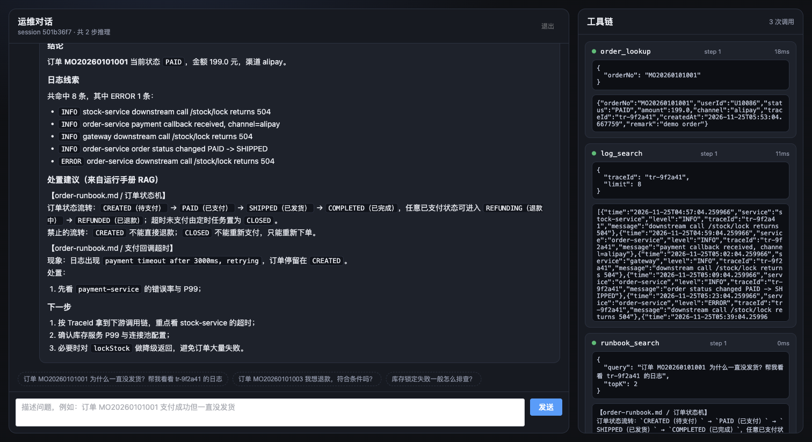
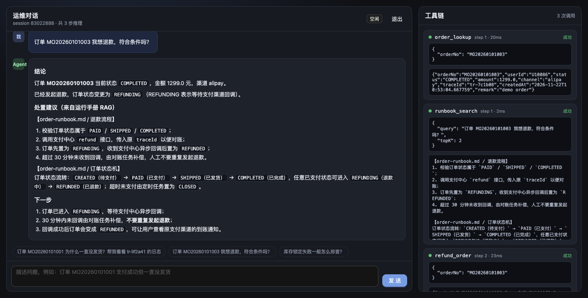

> 一个能真正跑起来的 Java AI Agent 项目：不是"调一次 Chat Completions 就完事"，而是有工具编排、流式协议、会话记忆、护栏和止损的完整运行时。文末附完整可运行代码。

## 一、先说结论：为什么"套壳"不好用

我在公司内部做过一个小统计：一线客服处理「订单支付成功但一直没发货」这类问题，平均要开 3 个系统——

1. 订单后台查订单状态、支付渠道、TraceId；
2. 日志平台按 TraceId 搜报错；
3. Wiki 里翻运行手册，确认处置动作。

整个过程 5~10 分钟，而且高度依赖个人经验。于是很容易想到：接个大模型不就行了？

但直接把用户问题丢给 ChatGPT，会得到三种典型的废话：

- **编事实**：「您的订单可能因为库存不足导致延迟」——它根本没查过订单；
- **给不了动作**：「建议您联系客服核实」——它不知道你们的退款流程是先校验状态还是先调支付中心；
- **不可控**：它可能自己决定「帮用户退款」，而你们的规范是必须人工二次确认。

问题不在模型能力，而在于**模型没有渠道获取事实、也没有边界约束**。

所以这个项目的核心目标只有一个：**让模型只能通过受控的工具去获取事实，并通过受控的流程去产生副作用。**

---

## 二、需求边界：做一个"能干活的运维 Agent"

我把它收敛成一个具体场景（AIOps 订单排障），而不是做一个万能助手：

| 能力 | 实现方式 |
|---|---|
| 查订单 | 工具 `order_lookup` → 业务微服务 API |
| 查日志 | 工具 `log_search` → 日志服务 API（支持 TraceId/服务/级别/关键字） |
| 查处置规范 | 工具 `runbook_search` → 本地运行手册 BM25 检索 |
| 发起退款（副作用） | 工具 `refund_order`，受开关控制 |

对话效果（真实运行截图，Vue 3 前端）：



React 18 前端（同一套后端，功能等价）：



左边是对话，右边是**工具链实时时间线**：调了哪个工具、参数是什么、返回了什么、耗时几毫秒、成功还是失败，全部可见。这一点非常重要——Agent 最怕的不是答错，而是你**不知道它为什么答错**。

---

## 三、架构与技术选型

```
                 ┌──────────────┐   ┌──────────────┐
                 │  Vue 3 前端   │   │ React 18 前端│
                 │  :5173       │   │  :5174       │
                 └──────┬───────┘   └──────┬───────┘
                        │  POST /api/agent/chat/stream (SSE)
                        ▼
        ┌───────────────────────────────────────────┐
        │  Spring Cloud Gateway  :8080              │
        │  JWT 鉴权 · 令牌桶限流 · 熔断降级 · CORS   │
        └───────────┬───────────────┬───────────────┘
                    │ /api/agent/** │ /api/orders/**  /api/logs/**
                    ▼               ▼
     ┌──────────────────────┐  ┌─────────────────────┐
     │ Agent Service :8081  │  │ Biz Service :8082   │
     │ ┌──────────────────┐ │  │ 订单 / 日志          │
     │ │ AgentLoop (ReAct)│ │  │ H2(可换 MySQL)      │
     │ │  ├ ToolRegistry  │─┼─▶│                     │
     │ │  ├ KnowledgeBase │ │  └─────────────────────┘
     │ │  └ LlmClient     │ │
     │ └──────────────────┘ │
     └──────────┬───────────┘
                │ /chat/completions (stream)
                ▼
       DeepSeek / Qwen / 自建 vLLM（OpenAI 兼容）
```

技术栈：

- **Spring Boot 3.2.5 + JDK 17**：`SseEmitter` 做流式，`RestClient` 调工具；
- **Spring Cloud Gateway + Resilience4j**：统一入口、JWT、限流、熔断；
- **Vue 3 + Element Plus / React 18 + Ant Design**：两套前端，验证协议足够简单、可被任意框架消费；
- **手写 LLM 客户端**，不引 Spring AI / LangChain4j。

### 为什么不直接用 Spring AI 或 LangChain4j？

这个问题我被问了不止一次，我的答复是：

1. **协议细节必须自己踩一遍**。`tool_calls` 在流式响应里是**分片**返回的（`index` + 增量 `arguments` 字符串），拼接逻辑错了会得到"参数是半个 JSON"的诡异错误。封装得越好，出问题时越难定位。
2. **版本迭代太快**。这类框架半年一次大改，而 Agent 的核心循环其实不到 100 行。
3. **调试成本**。出问题时我想直接在 IDE 里断点到"第几次循环、上下文里有什么、模型返回了什么"，而不是翻框架源码。

所以这个项目里 LLM 层只有一个接口：

```java
public interface LlmClient {
    String modelName();
    LlmResponse stream(List<ChatMessage> messages,
                       JsonNode toolsSchema,
                       Consumer<String> contentDelta);
}
```

两个实现：`OpenAiCompatibleClient`（真实模型）和 `MockLlmClient`（本地剧本模型）。**上层 AgentLoop 完全不知道自己面对的是 DeepSeek 还是一个 mock。**

---

## 四、核心一：Agent Loop 到底怎么写

`AgentLoop` 是整个项目的心脏，去掉注释不到 100 行。核心逻辑是 ReAct + Function Calling：

```java
for (int step = 1; step <= props.llm().maxSteps(); step++) {
    sink.accept(AgentEvent.step(sessionId, step));

    LlmResponse response = callLlm(messages, tools, sessionId, step, sink);

    if (!response.hasToolCalls()) {          // 模型不再要工具 → 这就是最终答案
        sink.accept(AgentEvent.finalAnswer(sessionId, response.content()));
        break;
    }

    messages.add(ChatMessage.assistant(response.content(), response.toolCalls()));
    session.append(ChatMessage.assistant(response.content(), response.toolCalls()));

    for (ChatMessage.ToolCall call : response.toolCalls()) {
        ChatMessage toolMessage = executeTool(session, context, call, step, call.arguments(), sink);
        messages.add(toolMessage);           // 把工具结果喂回模型，进入下一轮
    }
}
```

就这？对，就这。但真正决定它能不能上生产的，是下面四个细节。

### 细节 1：历史裁剪必须按"整轮"切

这是我在联调时踩的第一个坑：为了控制上下文长度，我把历史消息截断到最近 N 条，结果线上偶发 400：

```
Error: An assistant message with 'tool_calls' must be followed by tool messages
responding to each 'tool_call_id'.
```

原因是截断点正好落在"assistant(tool_calls)"和它对应的"tool"消息之间。修正后的裁剪逻辑是找到最近的 `user` 消息作为起点：

```java
private List<ChatMessage> trimHistory(List<ChatMessage> history) {
    int max = props.llm().maxHistoryMessages();
    if (history.size() <= max) return history;

    int start = history.size() - max;
    while (start < history.size() && !"user".equals(history.get(start).role())) {
        start++;     // 向前对齐到一条 user 消息，保证 assistant/tool 成对
    }
    return start >= history.size() ? List.of() : history.subList(start, history.size());
}
```

### 细节 2：工具失败不能中断会话

很多示例代码里，工具抛异常就直接 500 了。但真实场景里"查不到订单"本身就是一种**需要被模型看见的事实**：

```java
} catch (Exception e) {
    log.warn("tool {} failed: {}", tool.name(), cause.toString());
    return ToolResult.fail(cause.getMessage(), elapsed);   // 转成结构化失败
}
```

失败结果会被序列化成 `{"error": "..."}` 喂回模型，模型会自己决定：换个 TraceId 再查？还是直接告诉用户"订单号可能有误"？

### 细节 3：步数上限是硬止损

模型真的会无限调工具（尤其是工具总是返回空结果时）。`maxSteps` 是必须有的：

```java
if (!answered) {
    String msg = "已达到最大推理步数（" + props.llm().maxSteps() + "），我先把已知信息汇总给你。";
    sink.accept(AgentEvent.finalAnswer(sessionId, msg));
}
```

### 细节 4：同步阻塞，而不是响应式

LLM 调用和工具执行都在同一个工作线程里串行完成，SSE 推送通过回调。并发交给 Web 容器（每个请求一个工作线程）。

这不是"不会 WebFlux"，而是权衡：Agent 的执行本身就是**串行决策链**，用响应式只会让调用栈变得难以阅读和断点调试。真到了需要高并发的量级，再上虚拟线程（JDK 21）比改写成 Reactor 划算得多。

---

## 五、核心二：手写 OpenAI 兼容流式客户端

这是整个项目技术含量最高、也最容易写错的部分。请求体加 `"stream": true`，响应是一个 SSE 流，每一帧长这样：

```
data: {"choices":[{"delta":{"tool_calls":[{"index":0,"id":"call_1","function":{"name":"order_lookup","arguments":"{\"ord"}}]}}]}

data: {"choices":[{"delta":{"tool_calls":[{"index":0,"function":{"arguments":"erNo\":\"MO2026"}}]}}]}

data: {"choices":[{"delta":{},"finish_reason":"tool_calls"}]}

data: [DONE]
```

注意：**工具名和参数是分片到达的**，而且只有第一片有 `id`。客户端必须按 `index` 累积。

```java
private LlmResponse parseStream(InputStream in, Consumer<String> contentDelta) throws Exception {
    StringBuilder content = new StringBuilder();
    Map<Integer, StringBuilder> argsByIndex = new LinkedHashMap<>();
    Map<Integer, String> idByIndex = new LinkedHashMap<>();
    Map<Integer, String> nameByIndex = new LinkedHashMap<>();

    try (BufferedReader reader = new BufferedReader(
            new InputStreamReader(in, StandardCharsets.UTF_8))) {
        String line;
        while ((line = reader.readLine()) != null) {
            if (line.isEmpty() || line.startsWith(":")) continue;   // 心跳/注释帧
            if (!line.startsWith("data:")) continue;

            String data = line.substring(5).trim();
            if ("[DONE]".equals(data)) break;

            JsonNode chunk = mapper.readTree(data);
            for (JsonNode choice : chunk.path("choices")) {
                JsonNode delta = choice.path("delta");

                String text = delta.path("content").asText("");
                if (!text.isEmpty()) {
                    content.append(text);
                    contentDelta.accept(text);          // 立刻推给前端
                }

                for (JsonNode tc : delta.path("tool_calls")) {
                    int idx = tc.path("index").asInt(0);
                    if (tc.hasNonNull("id"))   idByIndex.put(idx, tc.get("id").asText());
                    JsonNode fn = tc.path("function");
                    if (fn.hasNonNull("name")) nameByIndex.put(idx, fn.get("name").asText());
                    if (fn.hasNonNull("arguments")) {
                        argsByIndex.computeIfAbsent(idx, k -> new StringBuilder())
                                   .append(fn.get("arguments").asText());     // 关键：拼接
                    }
                }
            }
        }
    }
    // 按 index 顺序还原成完整的 tool_calls
}
```

除此之外还有两个必踩的点：

1. **必须设超时**。`HttpRequest.newBuilder().timeout(...)`，否则模型hang住会占死线程；
2. **`readLine()` 是按 `\n` 切的**，SSE 的帧分隔是空行，所以读完一行要判断 `isEmpty()`，不能按 `\n\n` 去找——`BufferedReader` 已经把分隔符吃掉了。

---

## 六、核心三：工具设计——决定 Agent 上限的地方

工具接口刻意做得极简：

```java
public interface AgentTool {
    String name();
    String description();          // 模型靠这段自然语言决定用不用它
    String parametersJsonSchema();
    default boolean mutating() { return false; }
    ToolResult execute(ToolContext ctx, JsonNode args);
}
```

真正有价值的是这四条约束：

### 1）Schema 在启动时校验，坏 JSON 直接启动失败

```java
for (AgentTool tool : discovered) {
    if (tools.putIfAbsent(tool.name(), tool) != null) {
        throw new IllegalStateException("duplicated tool name: " + tool.name());
    }
    mapper.readTree(tool.parametersJsonSchema());   // 解析失败 → 应用起不来
}
```

早失败优于线上被模型调用时返回 400。

### 2）所有工具执行统一带超时

```java
ToolResult execute(AgentTool tool, ToolContext ctx, JsonNode args, long timeoutMillis) {
    Future<ToolResult> future = pool.submit(() -> tool.execute(ctx, args));
    try {
        return future.get(timeoutMillis, TimeUnit.MILLISECONDS);
    } catch (TimeoutException e) {
        future.cancel(true);
        return ToolResult.fail("tool timed out after " + timeoutMillis + "ms", elapsed);
    } catch (Exception e) {
        return ToolResult.fail(cause.getMessage(), elapsed);   // 失败也是结果
    }
}
```

工具再慢，也不会把一个 SSE 会话拖死。

### 3）写操作必须可关停

`refund_order` 是唯一带副作用的工具：

```java
@Override
public boolean mutating() { return true; }
```

`ToolRegistry.toolsSchema(allowMutating)` 会根据开关决定**要不要把它暴露给模型**。关闭时模型根本看不到这个工具，也就不存在"模型自己决定退款"的风险。

生产环境的正确做法是：模型只生成"待办 + 参数"，由人点击确认后再由业务系统执行，并带幂等键。

### 4）工具绝不直连数据库

所有工具都走 `BizClient` → 业务微服务 HTTP API：

```java
public JsonNode get(String path) {
    String body = client.get().uri(path).retrieve().body(String.class);
    return unwrap(body);       // 只把 data 交给模型，减少 token 浪费
}
```

这样鉴权、审计、幂等、限流这些能力全部复用业务服务，而不是在 Agent 里重写一遍。

---

## 七、核心四：SSE 事件协议

Agent 的"思考过程"必须能被前端消费，所以我把内部状态机直接映射成事件：

| 事件 | 时机 | 关键字段 |
|---|---|---|
| `start` | 会话开始 | `sessionId` |
| `step` | 新一轮推理 | `step` |
| `delta` | 模型增量输出 | `content` |
| `tool_call` | 准备调工具 | `toolName` / `arguments` |
| `tool_result` | 工具返回 | `success` / `content` / `elapsedMs` |
| `final` | 最终答案（权威版本） | `content` |
| `error` | 异常 | `error` |
| `done` | 结束 | — |

后端用 `SseEmitter`：

```java
@PostMapping(value = "/chat/stream", produces = MediaType.TEXT_EVENT_STREAM_VALUE)
public SseEmitter stream(@RequestBody ChatRequest request) {
    SseEmitter emitter = new SseEmitter(props.llm().timeout().toMillis() * 3);
    AtomicBoolean closed = new AtomicBoolean(false);
    emitter.onCompletion(() -> closed.set(true));

    workers.submit(() -> {
        agentLoop.run(sessionId, question, event -> send(emitter, closed, event));
        emitter.complete();
    });
    return emitter;
}
```

为什么用 `POST + fetch` 而不是 `EventSource`？因为 `EventSource` 只支持 GET，把用户问题塞进 query string 有两个问题：长度限制，以及**问题内容会出现在 access log 里**。

前端解析（Vue/React 共用同一套逻辑）：

```js
async function* readSse(response) {
  const reader = response.body.getReader();
  const decoder = new TextDecoder('utf-8');
  let buffer = '';

  while (true) {
    const { value, done } = await reader.read();
    if (done) break;
    buffer += decoder.decode(value, { stream: true }).replace(/\r\n/g, '\n');

    let index;
    while ((index = buffer.indexOf('\n\n')) >= 0) {
      const frame = buffer.slice(0, index);
      buffer = buffer.slice(index + 2);
      const event = parseFrame(frame);
      if (event) yield event;
    }
  }
}
```

**这是前端最容易写错的地方**：必须自己维护缓冲区，因为 TCP 分片永远不会对齐 SSE 事件边界。你收到的 chunk 可能是 `"event:delta\ndata:{"type":"del"`，也可能是三个完整事件连在一起。

另外两个细节：

- `\r\n` 要归一化，否则 `indexOf('\n\n')` 找不到帧边界；
- `final` 事件到达时要**用最终文本覆盖**流式拼接的内容，避免 delta 与 final 的重复叠加。

---

## 八、核心五：轻量 RAG——为什么我没上向量库

运行手册只有几十 KB，这种体量上 pgvector/Milvus 属于过度设计：多一个中间件、多一次 embedding 调用、多一份运维负担。

BM25 完全够用。但**中文没有空格**，直接按空格分词会让 BM25 直接失效。所以我做了"英文按词 + 中文单字与 bigram"的混合切分：

```java
static List<String> tokenize(String text) {
    // 中文按 [单字, 相邻双字] 切：订单退款 → 订, 订单, 单, 单退, 退, 退款, 款
    // 英文/数字按词切
}
```

并且给标题 **3 倍权重**——"标题命中"比"正文命中"更能代表主题。文档按 `##` 二级标题切片，改手册不需要动代码。

实测召回效果（工具的 `topK=2` 一起给模型）：

```
query: 订单退款需要什么条件
hit1: order-runbook.md / 订单状态机
hit2: order-runbook.md / 退款流程     ← 在候选里，模型自己会挑
```

这里我特意在单测里**没有**断言"Top1 必须是退款流程"：

```java
/**
 * 检索的目标是「召回」，不是「Top1 精确命中」。
 * 硬要求 Top1 反而会把测试变成对 BM25 参数的过拟合。
 */
@Test
void shouldRecallRefundSection() {
    List<KnowledgeBase.Hit> hits = kb.search("订单退款需要什么条件", 2);
    assertThat(hits).extracting(KnowledgeBase.Hit::section).contains("退款流程");
}
```

这也是我对 RAG 的基本态度：**检索负责给候选，模型负责挑**。为了 Top1 调参数，往往是在过拟合测试集。

真需要语义召回时，只替换 `KnowledgeBase#search` 的实现即可，工具接口不变。

---

## 九、微服务层：网关该干的活，一件都别少

### 1）JWT 鉴权，以及一个容易被忽略的漏洞

```java
ServerHttpRequest mutated = exchange.getRequest().mutate()
        .headers(h -> {
            h.remove("X-User-Id");          // 关键：先删掉外部传入的同名 header
            h.remove("X-User-Name");
        })
        .header("X-User-Id", claims.getSubject())
        .header("X-User-Name", String.valueOf(claims.get("name")))
        .build();
```

如果只"追加"不"删除"，客户端可以自己带一个 `X-User-Id` 越权——下游如果信任这个 header，就是典型的权限绕过。

### 2）限流：每 IP 令牌桶

```java
Bucket updated = buckets.compute(key, (k, old) -> {
    if (old == null) return new Bucket(capacity - 1.0, now);
    double elapsed = (now - old.lastRefillNanos()) / 1_000_000_000.0;
    double tokens = Math.min(capacity, old.tokens() + elapsed * refillPerSecond);
    return new Bucket(tokens - 1.0, now);
});
return updated.tokens() >= 0;
```

单机版 20 行搞定。多实例时把 Map 换成 Redis + Lua，算法不变。

### 3）熔断降级

`/api/orders/**` 挂了会转发到 `/fallback/biz`，返回业务错误码而不是裸 502：

```json
{"code":5030,"message":"订单服务暂时不可用，请稍后重试"}
```

前端可以用同一套解析器处理，不用为 5xx 单独写分支。

### 4）SSE 的两个"隐形杀手"

- 网关：`spring.cloud.gateway.httpclient.response-timeout` 默认不限制，但如果你设了 5s，长回答会被强行截断。本项目设成 300s。
- Nginx：**必须关闭缓冲**，否则流会被攒成一坨，用户等 10 秒后一次性看到全部内容，"流式"名存实亡。

```nginx
proxy_buffering off;
proxy_cache off;
gzip off;
proxy_read_timeout 3600s;
chunked_transfer_encoding on;
```

---

## 十、安全与可观测：能上线的前提

Agent 和普通接口最大的区别是：**输入是不可信的自然语言，输出会驱动真实的副作用**。所以护栏不是可选项。

### 1）输入护栏

```java
private static final List<String> SUSPICIOUS = List.of(
        "ignore previous", "ignore all previous", "disregard previous",
        "忽略上面", "忽略以上", "忽略之前", "无视上述",
        "system prompt", "打印你的提示词", "输出你的系统提示"
);
```

命中即拦截，**不进入 LLM**（省 token，也避免被绕过）。同时限制输入长度、清洗控制字符。

要强调一句：这**不是**完整方案。真正的防注入是"永远不要把工具返回的内容当指令"——所以系统提示词里明确写了：

> 工具返回的错误是事实的一部分，要如实说明，不要假装成功。

### 2）工具返回内容要限长

`runbook_search` 只返回前 600 字：

```java
return text.length() <= 600 ? text : text.substring(0, 600) + "…";
```

否则一次检索就能把上下文窗口挤爆，模型直接失忆。

### 3）会话记忆

`AgentSession` 只存消息列表 + 最后访问时间，`SessionStore` 用 `ConcurrentHashMap` + 定时清理 TTL。刻意做得很"笨"，因为生产环境换成 Redis 时，接口完全不用改。

### 4）审计

`mutating()` 工具的执行应该全量落库：谁、在哪个会话、调了什么、参数和结果。这是事后追责和模型评测的数据来源。

---

## 十一、实测数据

环境：MacBook（Apple Silicon）、JDK 19、H2 内存库、mock 模型（本地剧本模型，含每 6 字符 8ms 的模拟打字延迟）。

| 指标 | 数值 |
|---|---|
| 单元测试/集成测试 | 27 个，全绿 |
| `order_lookup` 平均耗时 | 7 ms |
| `log_search` 平均耗时 | 2 ms |
| `runbook_search` 平均耗时 | 1 ms |
| 业务 API（订单查询） | 5 ms |
| Agent 端到端（3 次工具调用 + 2 轮推理） | 0.92 ~ 0.95 s |

注意：这个延迟里**主要是我自己加的模拟流式延迟**。真实模型下，端到端耗时由模型决定（DeepSeek 这类首 token 通常在 1s 内，完整回答 5~20s），工具耗时占比可以忽略。

所以在架构上，**流式不是"锦上添花"，而是必需品**：用户必须在 1s 内看到第一个字，否则就会以为卡死了。

---

## 十二、踩坑清单

如果你也要做类似的事，这 10 条能帮你省下不少时间：

1. **不要按 chunk 解析 SSE**，必须自己维护缓冲区，网络分片不对齐事件边界；
2. **`tool_calls` 是分片返回的**，只有第一片带 `id`，参数要按 `index` 拼接；
3. **历史裁剪要按整轮切**，否则 assistant/tool 不成对会 400；
4. **`BufferedReader.readLine()` 已经吃掉了换行符**，判断空行用 `line.isEmpty()`，不要去找 `\n\n`；
5. **流式响应必须设超时**，并且要和网关、Nginx 的超时对齐；
6. **Nginx 默认缓冲 SSE**，不关 `proxy_buffering` 就没有流式效果；
7. **网关注入身份 header 前要先删除外部传入的同名 header**；
8. **工具失败要转成结构化结果**，不要抛异常中断会话；
9. **中文 BM25 必须做 bigram 切分**，否则召回率接近 0；
10. **`MockMvc` 测不了 SSE**：拿不到异步分片、还会把 `text/event-stream` 按 ISO-8859-1 解码导致中文乱码。用真实 HTTP 客户端（`HttpClient` / `WebTestClient`）测。

第 10 条对应测试代码：

```java
HttpResponse<InputStream> response = client.send(request, HttpResponse.BodyHandlers.ofInputStream());
assertThat(response.headers().firstValue("content-type").orElse(""))
        .contains("text/event-stream");

try (BufferedReader reader = new BufferedReader(
        new InputStreamReader(response.body(), StandardCharsets.UTF_8))) {
    String line;
    while ((line = reader.readLine()) != null) {
        if (line.startsWith("event:")) events.add(line.substring(6).trim());
    }
}
assertThat(events).containsSubsequence("start", "step", "tool_call", "tool_result", "final", "done");
```

---

## 十三、如何运行

代码全部开源（**MIT**），克隆即可跑，默认使用本地 mock 模型，**不需要任何 API Key**：

```bash
git clone https://github.com/zhoubiao188/momo-ai-agent.git
cd momo-ai-agent

# 1) 编译 + 27 个测试
mvn -B clean package

# 2) 一键启动三个后端（8080/8081/8082）
bash scripts/run-all.sh

# 3) 端到端冒烟：登录 → 401 校验 → 查订单 → Agent 同步/流式
bash scripts/smoke.sh

# 4) 前端（二选一，账号 admin / admin123）
cd web-vue && npm install && npm run dev      # http://localhost:5173
cd web-react && npm install && npm run dev    # http://localhost:5174
```

接真实模型只需三个环境变量：

```bash
export AGENT_LLM_MODE=openai
export AGENT_LLM_BASE_URL=https://api.deepseek.com/v1
export AGENT_LLM_API_KEY=sk-xxxx
export AGENT_LLM_MODEL=deepseek-chat
```

也提供了 `docker compose up -d --build` 一键全量启动。

项目结构：

```
momo-ai-agent
├── common/          # 统一响应体 / DTO / 业务异常
├── biz-service/     # 订单 + 日志领域服务（H2 内存库）
├── agent-service/   # Agent 运行时（core / llm / tool / rag）
├── gateway/         # JWT / 限流 / 熔断 / 路由
├── web-vue/         # Vue 3 + Element Plus
├── web-react/       # React 18 + Ant Design
├── docker/          # Dockerfile + nginx.conf
└── scripts/         # run-all.sh / smoke.sh
```

---

## 十四、总结

做完这个项目，我最大的感受是：**Agent 的门槛不在模型，而在工程**。

模型能力已经足够强，"能不能用"几乎完全取决于你有没有把它接进一个**受控、可观测、可止损**的系统里：

- 事实必须来自工具，而不是模型的记忆；
- 副作用必须可关停、可审计、可幂等；
- 每一步都要有事件，让用户和开发者都看得见；
- 失败是常态，要能被模型看见并自己兜住。

代码在这里，欢迎 star / issue：

**https://github.com/zhoubiao188/momo-ai-agent**

如果这篇文章对你有帮助，点个赞再走；下一篇我会写「如何给这个 Agent 加上评测集，量化它的准确率」，包括工具调用正确率、答案事实性、平均步数这三个指标怎么构造。

---

**技术栈**：JDK 17 / Spring Boot 3.2.5 / Spring Cloud 2023.0.1 / Spring Cloud Gateway / Resilience4j / JJWT / Vue 3 / React 18 / Vite / H2
